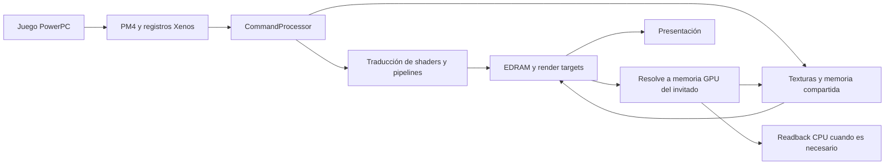

# 02 — Cómo se corrigen los gráficos y cómo investigar nuevos defectos

## Recorrido del renderizador

El juego genera shaders Xenos y paquetes PM4. `gpu/command_processor.cc` interpreta comandos y registros; los traductores DXBC/SPIR-V convierten shaders; los backends D3D12/Vulkan construyen pipelines y recursos. `render_target_cache.*` representa los destinos EDRAM; `texture_cache.*`, `texture_util.*` y `shared_memory.*` representan texturas y memoria compartida. Los resolves trasladan resultados de EDRAM a la memoria del invitado; readback permite que la CPU reciba algunos de esos datos.

Mapa local: `engine/xenia/src/xenia/gpu/`. Los nombres de funciones y ubicaciones auditadas figuran en [inventario-local.json](inventario-local.json); la revisión pública de referencia es [Netplay fijado](https://github.com/AdrianCassar/xenia-canary/tree/6dbaa1fefd1e07cc3d5377e763c68fe8073cbe8c/src/xenia/gpu).

## 1. EDRAM: corregir las interpretaciones de una misma memoria

Un render target moderno suele representarse como una imagen independiente. El juego de Xbox 360 puede reutilizar la misma zona EDRAM como color, profundidad, stencil, otro formato u otra organización de muestras. Si el emulador conserva imágenes sin reconstruir la relación entre esas vistas, puede producir iluminación negra, bloques, transparencias mal recortadas o datos antiguos. Los defectos no necesariamente nacen en el shader que los muestra.

### Disposición canónica de muestras: PR 1163

El cambio [`437a7280cf95`](https://github.com/xenia-canary/xenia-canary/commit/437a7280cf95310d518a2f68087aab61403956ac), [PR 1163](https://github.com/xenia-canary/xenia-canary/pull/1163), unifica direcciones EDRAM entre vistas 1x, 2x y 4x. El layout anterior podía funcionar cuando lectura y escritura compartían el mismo error. Fallaba cuando el juego reinterpretaba muestras de un destino reducido como píxeles de otro destino de mayor resolución.

La corrección coordina shaders de resolve, transferencias entre vistas, almacenamiento de profundidad y operaciones ROV/FSI. También mantiene la identidad de una muestra de 64 bits al observar sus dos mitades mediante un alias de 32 bits. En escalado, convierte coordenadas a nivel de píxel invitado y preserva la posición del subpíxel host.

**Presente localmente:** el diff exacto se puede invertir en el árbol actual. No es una mejora pendiente. **Lección:** cambiar solo un resolve o solo el traductor puede romper la simetría entre componentes; revisar el recorrido completo. El [arreglo posterior de copia de profundidad 2x/4x](https://github.com/xenia-canary/xenia-canary/commit/0bd090dbe979bc64959efe519aa320db8e3eb467) figura como candidato en la auditoría.

### Alias disjuntos de color y profundidad: PR 1222

[`9da693480d09`](https://github.com/xenia-canary/xenia-canary/commit/9da693480d0995326b81c3a14f8b1a4c226066eb), [PR 1222](https://github.com/xenia-canary/xenia-canary/pull/1222), aborda sprites y nubes que seguían visibles a través de geometría en **Gears Judgment**. Si una escritura de color solo modifica bits no usados por el test de profundidad, no se debe desactivar ese test por compartir dirección EDRAM.

En ROV/FSI compara máscaras de bits de color con los usados por profundidad/stencil. En targets host añade seguimiento de propiedad de los bits de profundidad y conserva el depth target de solo lectura cuando el alias escribe únicamente bits stencil no usados. Si los bits se solapan, se escribe profundidad o hay condiciones no cubiertas, vuelve a la ruta anterior. Introduce `aliased_depth_read_only`.

**Candidato aplicable localmente.** La utilidad para otros títulos UE3.5 es una sospecha del autor, no una validación general. Para portarlo: capturar el draw defectuoso, formatos y masks, comprobar ambas rutas y hacer una comparación en Judgment. No concluir que todos los sprites atravesando paredes tienen esta causa.

## 2. ROV/FSI frente a render targets del host

Los targets host aprovechan blend/depth/stencil nativos y pueden ser rápidos, pero requieren representar diferencias de formatos y alias. ROV en D3D12 y fragment shader interlock en Vulkan permiten ordenar accesos y emular parte del procesamiento EDRAM en shaders, con mayores costes potenciales y requisitos de hardware.

Los nombres exactos del selector son `render_target_path_d3d12` y `render_target_path_vulkan`; consultar sus `DEFINE_*` y los valores admitidos en la revisión antes de crear perfiles. La detección de capacidades y fallbacks importa: solicitar una ruta no prueba que se haya utilizado.

La [documentación de Microsoft sobre rendering](https://learn.microsoft.com/en-us/windows/win32/direct3d12/rendering) explica el ordenamiento de accesos UAV mediante ROV. Esto no hace equivalentes todos los comportamientos Xenos. El modelo concreto lo implementa Xenia.

**Método:** comparar target host y ROV/FSI a resolución nativa con la misma escena. Si solo una ruta falla, investigar transferencia/representación o código específico del backend; si ambas fallan, comenzar por registros, interpretación PM4 y traductores compartidos. Es una heurística, no una prueba concluyente. Registrar VRAM y tiempo GPU antes de elegir un valor por juego.

## 3. Oclusión: de valores falsos a contadores del hardware

### Implementación ZPD de mayo: PR 1016

La base local sigue el modelo de [PR 1016](https://github.com/xenia-canary/xenia-canary/pull/1016), ampliado posteriormente en su rama. Interpreta `EVENT_WRITE_ZPD`, mantiene informes lógicos que pueden dividirse entre submissions/render passes, y retira resultados de forma asíncrona. Reutilizar una dirección del invitado no autoriza sobrescribir un informe anterior aún pendiente.

RTV/FBO usan queries host; ROV/FSI cuentan cobertura en buffers mediante los shaders. El escalado requiere normalizar muestras para que el invitado no interprete una pantalla 2x2 como cuatro veces más visibilidad.

| `occlusion_query` local | Comportamiento | Coste/riesgo |
| --- | --- | --- |
| `fake` | Produce datos sin consultar realmente la visibilidad | Puede mantener flares y objetos visibles incorrectamente |
| `fast` | Escribe una estimación/cache y actualiza con la respuesta real | Menos espera; respuesta potencialmente antigua |
| `fast-alt` | Conserva ceros en algunos informes pendientes | Puede ayudar efectos y perjudicar el culling |
| `strict` | Espera datos reales | Mayor fidelidad de respuesta; sincronización y rendimiento peores en algunos casos |

En la base, `fast` es el valor inicial. `strict` no equivale a exactitud total del renderizador: un depth buffer mal representado produce un resultado incorrecto incluso con espera.

### Reescritura acumulativa de septiembre: PR 1218

[`3d233a5b2e94`](https://github.com/xenia-canary/xenia-canary/commit/3d233a5b2e94b940825847b70c788951e364bb33), [PR 1218](https://github.com/xenia-canary/xenia-canary/pull/1218), sustituye la inferencia de BEGIN/END por contadores acumulativos. El hardware emulado mantiene cuatro contadores de dos lanes y los vuelca al producirse el evento; D3D calcula diferencias entre informes. Cada evento cierra un intervalo y abre el siguiente.

Esto facilita QueryBatch y elimina parte de la máquina de estados heurística. `occlusion_query_full_counters` habilita contadores adicionales. En ROV/FSI se pueden separar ZPass, ZFail y StencilFail; con targets host la aproximación no puede separar completamente algunos rechazos. Activar esos caminos aumenta trabajo shader y no se propone como default universal.

**Candidato amplio aplicable**, no aplicado aquí. Retira `occlusion_query_saturation` y `occlusion_query_querybatch_range`. El catálogo Qt contiene ajustes del motor, por lo que habría que revisar `app/settings-catalog.json`, etiquetas, perfiles y migración de valores. La wiki de God Mode todavía menciona el nombre histórico `query_occlusion_querybatch_range`; la base local define `occlusion_query_querybatch_range`. No copiar esa receta sin verificar la revisión.

### Predicación VIZ_QUERY: PR 1111

[`692cd59cfef6`](https://github.com/xenia-canary/xenia-canary/commit/692cd59cfef6451314666d7f6d0b127ae78b14b3), [PR 1111](https://github.com/xenia-canary/xenia-canary/pull/1111), distingue consultas de visibilidad de las que cuentan muestras. Un proxy de geometría alimenta un resultado booleano usado para condicionar draws consumidores en GPU: `SetPredication` en D3D12 y `VK_EXT_conditional_rendering` en Vulkan.

Mantener la decisión en GPU evita algunas esperas de lectura CPU. La implementación tiene límites explícitos: ciertas surveys sin ID no están soportadas, la visibilidad puede diferir de hi-Z real, y memexport/copy deben ejecutarse. El primer draw con un shader nuevo no siempre puede predicarse porque podría exportar memoria.

**Contexto local divergente**: no incorporar aisladamente antes del modelo ZPD y de revisar pools, deferred command buffers y extensión Vulkan. La corrección de visibilidad también puede cambiar rendimiento al dejar de dibujar objetos ocultos; hay que demostrar ambas cosas.

## 4. Layout de texturas y muestreo

`texture_util.cc` determina tamaños, strides, direcciones tiled y packed mip tails. Las texturas 3D reducen profundidad por nivel; los arrays 2D conservan slices con alineación de almacenamiento. Leer un tamaño lógico como tamaño físico puede producir accesos incorrectos sin que el muestreo o el juego estén mal.

Correcciones inspeccionadas:

- [`bc6b7a020295`](https://github.com/xenia-canary/xenia-canary/commit/bc6b7a020295a7af21f5919c1d08e6054dc4fcd1): mip layout de arrays/volúmenes; candidato aplicable.
- [`89609297c7ae`](https://github.com/xenia-canary/xenia-canary/commit/89609297c7ae25dc5ba404c6a977260b806bb725): en resolves tiled 8/16bpp, parte del offset horizontal estaba en bits bajos de la base; debe recuperarse antes de calcular direcciones. El diff vincula el defecto a refracción de agua de `534307D5`; candidato aplicable.
- [PR 1250](https://github.com/xenia-canary/xenia-canary/pull/1250), [`c3cd8617b18e`](https://github.com/xenia-canary/xenia-canary/commit/c3cd8617b18ef018ea8d638c865e0cced7399846): ajusta fetchs puntuales a centros/valores de texel del invitado. El autor reporta arreglos de virtual texturing idTech 5 en AMD/NVIDIA y deja Intel Arc sin confirmar. Candidato aplicable.

El historial contiene más ajustes de bounds tiled 3D, pitch de 96bpp y packed tails. **Se localizaron sus entradas, no se auditaron íntegramente todos sus diffs.** Deben considerarse dependencias y candidatos de análisis, no mejoras listas para aplicar.

Para una textura corrupta: registrar fetch constant, formato, endianness, dimensión, pitch, base/mip address, nivel, slices y estado de dirty pages. Volcar RAM invitada y textura convertida. Si el volcado convertido ya está mal, el problema precede al shader de consumo. Comparar fronteras de tile y mip con una imagen sintética conocida.

## 5. Sincronización Vulkan y compilación paralela

[`c8f214e2a9b0`](https://github.com/xenia-canary/xenia-canary/commit/c8f214e2a9b0209ca8a0ad6cb3dfb155fe545ae2) conserva la barrera `TRANSFER_WRITE → TRANSFER_WRITE` entre dos uploads a la misma textura. Una función auxiliar descartaba barreras con masks/layouts iguales como si fueran vacías. Igualdad de estado no elimina la dependencia entre escrituras. La [especificación Vulkan](https://docs.vulkan.org/spec/latest/chapters/synchronization.html) exige dependencias de memoria para hazards de escritura tras escritura.

[`1b242658e535`](https://github.com/xenia-canary/xenia-canary/commit/1b242658e535fbd12645e4d2c12693771075b738) toma `layouts_mutex_` alrededor de vector/map de layouts compartidos durante traducción paralela. El autor reprodujo abortos de glibc en la precarga. La ruta D3D12 ya protegía el bloque equivalente. Ambos son candidatos aplicables y de alta prioridad por su alcance limitado y relación clara con el defecto.

Desactivar traducción paralela puede ocultar la carrera y empeorar tiempos de carga. La corrección consiste en proteger el estado compartido. Un `device lost` tampoco demuestra por sí mismo una GPU defectuosa: recopilar validación, recursos, tiempos y primer error antes de atribuirlo a driver, uso de memoria o shaders.

## 6. Precisión de shaders y mezcla

El comportamiento de instrucciones Xenos puede diferir de operaciones host de precisión completa: redondeo, normalización, NaN/Inf y reglas de swizzle importan. El arreglo [AC6 / precisión escalar](https://github.com/xenia-canary/xenia-canary/commit/3a44f20c7bc66db1da583e8a6f0ab740e31908e9) ya está presente y sustituye un hack por comportamiento más general. No reducir toda la aritmética a menor precisión: identificar instrucción y dominio exactos.

La corrección [alfa constante RTV](https://github.com/xenia-canary/xenia-canary/commit/4cc584f47d310c95d3686d8f4c9ffb052ee38fcc) ya está presente. Una configuración de mezcla mal representada puede confundirse con iluminación o transparencias rotas. Revisar blend RGB y alpha por separado, factores constantes y conversiones gamma.

## 7. Readback y resolución: ajustes con compromisos reales

| Opción de la base | Cuándo investigar | Precaución |
| --- | --- | --- |
| `readback_resolve = none/fast/full` | El juego usa en CPU un resolve para exposición u otro dato | `full` espera GPU; `fast` usa datos anteriores; **no hay `strict`** en esta opción |
| `readback_memexport` | El shader exporta datos que después lee CPU | Puede forzar sincronización a mitad de frame; no es necesario para consumidores solo GPU |
| `draw_resolution_scale_x/y` | Escalar imagen final | Empezar diagnóstico 1x1; 2x2 cuadruplica píxeles, no necesariamente el coste total |
| `draw_resolution_scale_threshold` | Postprocesado de pequeños targets falla al escalar | Solo targets host; se compara pitch alineado, no el tamaño visible de la ventana |
| `draw_resolution_scaled_texture_offsets` | Sombras/bloom cambian por offsets al escalar | Preservar la semántica por fetch y target |
| `depth_float24_convert_in_pixel_shader` | Diferencias de profundidad al recuperar datos de EDRAM | Puede reducir ventajas de compresión/early depth y aumentar shading por muestra |
| `depth_float24_round` | Casos particulares de redondeo en profundidad host | Interactúa con la anterior; ROV/FSI siguen su propia representación |
| `async_shader_compilation` | Tirones asociados a pipelines nuevos | Puede presentar artefactos breves mientras compila; comparar carga fría/caliente |

Valores y descripciones proceden de los `DEFINE_*` locales. `readback_resolve` tiene valor declarado `none` y una regla histórica `UPDATE_from_string(..., "fast")`; una instalación existente puede tener un valor migrado. Leer el TOML efectivo y argumentos antes de afirmar el ajuste usado.

## 8. Procedimiento de diagnóstico gráfico

1. Fijar build, Title ID, Media ID, hash de XEX, TU, backend, GPU/driver y configuración efectiva. Guardar escena, entrada y cámara reproducibles.
2. Probar resolución nativa sin parches de calidad opcionales. Cambiar una condición por comparación. La escena debe conservar iluminación y geometría comparables.
3. Capturar PM4 y shaders con las opciones `trace_gpu_stream`, `trace_gpu_prefix`, `dump_shaders` y herramientas de replay disponibles en la build; confirmar el alcance de la captura.
4. Localizar el primer recurso/pass incorrecto: upload, render, transferencia EDRAM, resolve, readback o composición. RenderDoc/PIX y la traza del emulador son complementarios; comprobar compatibilidad con sparse/tiled resources.
5. Formular una invariante comprobable: dirección equivalente entre alias, conservación de bits, igualdad de query delta o dependencia entre escrituras. Relacionarla con un diff upstream o hipótesis.
6. Validar el arreglo en la escena afectada y al menos un consumidor de la ruta compartida; incluir MSAA y escalado cuando el cambio los afecta. No adoptar un parche visual como corrección universal del core.

Este procedimiento es una propuesta de trabajo; no se ejecutaron capturas ni pruebas gráficas en esta investigación.

## 9. Perfiles de presentación incorporados el 5 de octubre de 2026

La interfaz añade [perfiles gráficos](../../GRAPHICS_PROFILES.md) globales y
por título, con retorno a los valores originales de resolución/postprocesado.
Usan controles ya presentes de escala entera, CAS, FSR 1.0, dithering y FXAA
(esta última etapa disponible en Direct3D 12). No alteran EDRAM, readback,
oclusiones ni otros ajustes de compatibilidad. Se mantiene Personalizado como
estado inicial para conservar configuraciones existentes.

Las etiquetas 720p/1080p/1440p/4K son orientativas desde una base de 720p; no
demuestran resolución nativa del juego, soporte de sparse/tiled de la GPU ni
mejor rendimiento. Consultar la ficha para el comportamiento de herencia,
precedencia, pruebas automatizadas y gameplay pendiente.

## 10. Zonas negras en personajes de Gears 1 y 3 — 7 de octubre de 2026

### Evidencia y alcance

El usuario identifica **Gears of War 1 y 3**, además de otros títulos sin
identificar, con partes negras en cara/cuerpo, especialmente en cinemáticas.
Es un **reporte del usuario**: esta revisión no reproduce una escena ni obtiene
una captura GPU del defecto. No se conocen misión, cámara, hash de Gears 1 ni
configuración efectiva del incidente. No se demuestra una causa común para
todos los títulos. Distinguir cinemática renderizada por el juego de vídeo
prerenderizado antes de atribuir el defecto al pipeline de materiales.

El core local continúa en Netplay
`6dbaa1fefd1e07cc3d5377e763c68fe8073cbe8c`, con los cambios propios existentes.
Canary consultado llega a `cc4981a4659086acb1c25a485adebefc3f432ae1`.
Los TOML se verificaron en game-patches
`106bb0a40be27b5a2444162562975e4885e1ce74`. Las consultas fueron de lectura;
no se activaron parches ni se sustituyeron ejecutables o configuraciones.

### Gears 1: modificación del juego y corrección del core son alternativas distintas

Los ficheros oficiales ofrecen `Black Shading Fix`, desactivado inicialmente:

| Edición | Hash de parches del módulo | Cambio inspeccionado |
| --- | --- | --- |
| [Base](https://github.com/xenia-canary/game-patches/blob/106bb0a40be27b5a2444162562975e4885e1ce74/patches/4D5307D5%20-%20Gears%20of%20War.patch.toml) | `1B591620508434A2` | `GUseTilingCode = FALSE`, byte `0x82bb6bbb = 0`; evita una interacción de iluminación dinámica y tiling MSAA |
| [TU5](https://github.com/xenia-canary/game-patches/blob/106bb0a40be27b5a2444162562975e4885e1ce74/patches/4D5307D5%20-%20Gears%20of%20War%20%28TU5%29.patch.toml) | `34849A59634915F6` | Mismo estado en `0x82f9779b`; su descripción indica que desactiva efectivamente MSAA |

Sirve como comparación diagnóstica por título/versión; no acredita una
corrección general del emulador y puede perder antialiasing. No copiar
direcciones entre ediciones ni cambiar el hash para forzar aplicación.

**Novedad upstream directamente relacionada:**
[`cc4981a46590`](https://github.com/xenia-canary/xenia-canary/commit/cc4981a4659086acb1c25a485adebefc3f432ae1),
publicada el 6 de octubre a las 19:48:42 UTC, reproduce posiciones MSAA de Xenos.
El autor vincula el sombreado ausente de `4D5307D5` a resolver profundidad de
la muestra 0 y volver a compararla con posiciones distintas en la GPU host.
La inspección de hunks seleccionados confirma cambios de viewport, shaders,
transferencias y transiciones en D3D12/Vulkan: 23 archivos, 810 adiciones y
279 eliminaciones. RTV/FBO incorporan `xenos_sample_positions`, **false** por
defecto y condicionado al soporte GPU/driver; ROV/FSI ajustan cobertura y
profundidad en shader. Este reporte upstream no valida nuestra build ni
Gears 3. Es un candidato relevante de alcance amplio, **sin portar ni compilar
en esta revisión**.

No aislar un cambio de viewport y omitir las transiciones/transferencias del
mismo contrato. La base diverge: el contexto D3D12 upstream contiene, por
ejemplo, `occlusion_query_full_counters`, ausente en el archivo local
inspeccionado. Eso exige revisar dependencias/equivalencias; no justifica
importar toda la reescritura de oclusión automáticamente. La propiedad de
capacidad D3D12 `GetProgrammableSamplePositionsTier` sí existe localmente.

### Gears 3 y candidatos relacionados

Los [parches base de Gears 3](https://github.com/xenia-canary/game-patches/blob/106bb0a40be27b5a2444162562975e4885e1ce74/patches/4D5308AB%20-%20Gears%20of%20War%203.patch.toml)
(`EF4AD5E9DD1982ED`) y TU6 disco/TU1 digital (`7775898137CE1CE3`)
no contienen un `Black Shading Fix` equivalente. Sí ofrecen desactivar AO y
recortar sombras mediante opciones de rendimiento. Esos recortes cambian
efectos y no demuestran que reparen la causa de las caras negras. No activar
conjuntos de parches sin una comparación que permita atribuir el resultado.

También merece evaluación [`0bd090dbe979`](https://github.com/xenia-canary/xenia-canary/commit/0bd090dbe979bc64959efe519aa320db8e3eb467):
corrige la dirección de muestras al copiar profundidad host 2x/4x a EDRAM.
**2x/4x son muestras MSAA, no escalas de resolución.** El diff afecta dos
shaders de copia; no prueba por sí mismo la causa del fallo reportado.
Layout de mips/arrays, alias color-profundidad y precisión de shaders siguen
como otras clases de defecto del capítulo, sin atribución a Gears 3.

`depth_float24_convert_in_pixel_shader` ya está en el core y en
`app/settings-catalog.json`; puede comparar problemas de profundidad al
recuperar EDRAM, pero tiene coste de compresión/shading por muestra y no
se recomienda como valor global. `depth_float24_round = false` es la
recomendación declarada del core. La compilación asíncrona puede causar
artefactos transitorios; no explica automáticamente un defecto persistente
tras calentar la caché. FSR/CAS y mayor resolución no reparan una pasada de
iluminación ausente.

### Próxima validación, antes de integrar al estable

1. Guardar escena reproducible, módulo/TU y configuración efectiva. Empezar
   a resolución 1x, comparando la misma cámara y luz sin recortes de calidad.
2. En Gears 1, usar el parche de sombreado correspondiente como comparación
   aislada si se decide probarlo; registrar imagen y pérdida de MSAA. Mantener
   esta modificación del juego separada del candidato de core.
3. Capturar el primer pase incorrecto: textura convertida, luz/material,
   profundidad/resolve o composición. Preparar el cambio coherente que esa
   evidencia justifique en una copia de prueba.
4. Para posiciones/copia MSAA, comprobar soporte host, muestras 1/2/4 y escala
   1x/escalada, sombras y transiciones de depth. Contrastar Gears 1, Gears 3 y
   consumidores de la ruta que ya funcionen; incluir sesiones Netplay de
   control antes de aceptar el motor como reemplazo del estable.
5. Registrar corrección visual, frametimes, errores y regresiones por separado.
   En esta revisión solo hay reporte del usuario, evidencia upstream e
   inspección estática; **no hay pruebas automatizadas nuevas ni gameplay
   validado de estas correcciones**.
