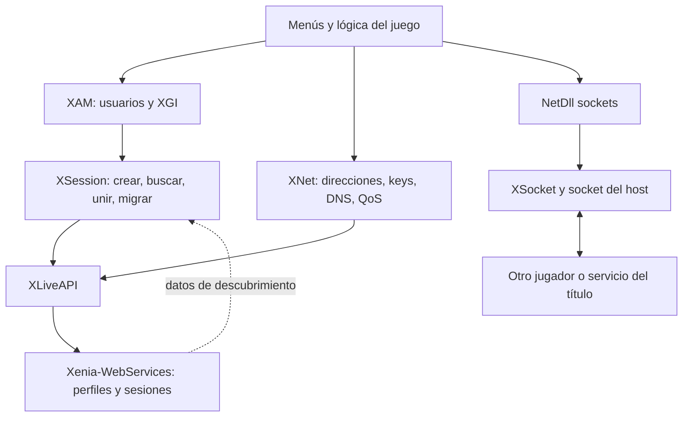

# 04 — Cómo funciona Netplay y qué falta para otros títulos

## Dos recorridos que se encuentran dentro del juego

Xenia Canary Netplay emula contratos de la plataforma que el juego utiliza para perfiles, sesiones, presencia, direcciones, QoS y sockets. El backend Xenia-WebServices aporta una API comunitaria. El juego sigue ejecutando su lógica de lobby y su protocolo de partida. No se observó un servicio universal que convierta cualquier juego offline en online, replique simulaciones por rollback o reenvíe todo el tráfico de todos los títulos.

Código principal local: `kernel/xam/apps/xlivebase_app.cc`, `kernel/xsession.*`, `kernel/xnet.h`, `kernel/xam/xam_net.*`, `kernel/xsocket.*`, `kernel/XLiveAPI.*`, `kernel/upnp.*` y `kernel/json/`. [Árbol Netplay fijado](https://github.com/AdrianCassar/xenia-canary/tree/6dbaa1fefd1e07cc3d5377e763c68fe8073cbe8c/src/xenia/kernel).

## 1. Perfil y servicios solicitados

Un perfil local debe estar habilitado para Netplay y tener el estado que las APIs de usuario esperan. `XSession::GetSessions` comprueba `IsSignedInToLive()` y puede devolver `X_ONLINE_E_SESSION_NOT_LOGGED_ON`. Seleccionar el modo de red o mostrar la identidad en Qt no sustituye ese estado.

Separar XUID del perfil, identidad online, MAC de consola, IP y session ID. Una misma IP puede representar varios participantes detrás de NAT; una caché indexada solo por IP puede no distinguirlos. Es un área a investigar, no un defecto demostrado de toda partida. Los perfiles y guardados existentes deben conservar su asociación; no regenerar IDs para eludir un error de sesión sin entenderlo.

En el fork, `network_mode` define `0` Offline, `1` System Link y `2` modo Xbox Live emulado; `api_address`, `api_list`, `bind_interface` y opciones de XStorage/XHTTP completan la configuración. En Emulos360 la aplicación persiste y pasa ajustes, y la edición privada añade pasarela. Registrar el valor efectivo usado por el proceso y el título: la base tiene soporte de transición de modo, no solo un número estático en la interfaz.

## 2. XGI y ciclo de vida de sesión

`xlivebase_app.cc` despacha mensajes de funcionalidades Live a operaciones del core. `XSession` representa creación, miembros, slots públicos/privados, contextos, propiedades, búsqueda, estadísticas, inicio/fin y migración. La abstracción debe reflejar cambios que el juego reconoce, no limitarse a publicar un JSON.

Hay una capa anterior que importa al ampliar compatibilidad: **online schema y unmarshaller**. `GetDispatchMessageID` comprueba el tamaño de `XLIVEBASE_ASYNC_MESSAGE`, obtiene el ordinal/schema de la tarea y compara su versión con el schema del core. Cuando no coinciden, busca el índice correspondiente al ordinal y remapea el message ID. El mismo número de mensaje no debe suponerse equivalente entre todas las versiones. Archivos: `kernel/xam/online_schema.h`, `kernel/xam/unmarshaller/schema_in_memory.*`, `generic_unmarshaller.*` y `xlivebase_task.*`. Si una operación nueva llega como un bloque genérico, revisar esa conversión antes de añadir un case con una firma inventada.

Recorrido conceptual habitual, cuya secuencia concreta depende del título:

1. El host solicita sesión y se devuelven handle/info/ID según flags y tipo.
2. El juego configura contextos y propiedades: modo, tipo, mapa, límites y datos propios.
3. La búsqueda del cliente consulta la API y devuelve estructuras guest, incluyendo propiedades en el orden esperado por la query.
4. QoS y conversión de direcciones suministran los datos usados para conectar/validar el lobby.
5. Prejoin/join actualizan identidad y miembros, y el juego negocia por sockets.
6. La partida ejecuta su protocolo. Inicio/fin, estadísticas y salida actualizan el estado.
7. Host migration requiere tanto metadata de sesión como transición del protocolo del juego; cambiar un campo del servidor no demuestra migración completa.

El fork conserva TODOs en skill/TrueSkill, búsqueda ponderada y quién envía determinadas estadísticas. No confundir una implementación que devuelve éxito con una réplica exacta del sistema original.

## 3. Cambios reales que ampliaron compatibilidad

| Cambio inspeccionado | Mecanismo | Evidencia local |
| --- | --- | --- |
| [`7835c486a2ed`](https://github.com/AdrianCassar/xenia-canary/commit/7835c486a2ed62f1f76ef5802f59f6988f4153ea) | IDs XNKID con clasificación y representación más fieles | Hunks presentes |
| [`8f326b1aeb73`](https://github.com/AdrianCassar/xenia-canary/commit/8f326b1aeb731431a99fce95e43eb1fe1d2fc552) | Filtrado por consulta/propiedades usando metadata XLast | El código está en la base, pero el diff completo diverge por evolución posterior |
| [`8bf03b0038a6`](https://github.com/AdrianCassar/xenia-canary/commit/8bf03b0038a6a0ee25643c53685a5ea5dd6bcc42) | Propiedades devueltas en orden de consulta | Hunks presentes |
| [`80553db6f58a`](https://github.com/AdrianCassar/xenia-canary/commit/80553db6f58ab65de12568024e61bab3f5f54665) | Prejoin para actualizar session ID del jugador | Funcionalidad en el código; diff completo divergente |
| [`6dbaa1fefd1e`](https://github.com/AdrianCassar/xenia-canary/commit/6dbaa1fefd1e07cc3d5377e763c68fe8073cbe8c) | Retira comprobación específica de tamaño cero en búsquedas por ID/IDs | Hunks presentes; **no eliminar toda validación de buffers** |
| [`ae18e30b8ff3`](https://github.com/AdrianCassar/xenia-canary/commit/ae18e30b8ff3a3dd2d617124dc10108133b01743) | Espera WSA sin deadlock de mutex/evento autoreset | Hunks presentes |

Estas correcciones son generales a contratos usados por juegos. No se encontró evidencia de que Gears se habilite simplemente con una lista de Title IDs o un único parche de red de la saga.

## 4. Búsqueda: filtros, orden y buffers importan

En el backend fijado, `SessionRepository.findAdvertisedSessions` selecciona sesiones anunciadas, no borradas, con contextos/propiedades y fuera de migración. Excluye al buscador y después aplica slots, capacidad, matchmaking, game mode/type y filtros de XLast. El controlador de propiedades puede ordenar el resultado según el query ID.

La versión upstream aplica `.limit(resultsCount)` **antes** de esos filtros adicionales. Si los primeros candidatos se descartan, una sesión válida posterior podría no aparecer. MultiP ya lo corrige en `server/prepare-upstream.cjs` y aplica un límite posterior. Esta es una mejora local existente, no una tarea pendiente ni una garantía de exhaustividad de todas las consultas.

En el código inspeccionado, `XLiveAPI::SessionSearch` envía `searchIndex`, `resultsCount`, `numUsers`, `searcher_xuid` y `filters`; los filtros combinan contextos y propiedades serializadas en base64. La creación de sesión incluye Media ID, versión, flags, slots, IP, MAC y puerto, y adjunta XLast serializado si existe. `util/xlast.cc` descomprime/interpreta XML y expone parámetros, returns y filtros de las queries. Esto explica cómo la implementación puede adaptarse a metadata de varios títulos sin incorporar un if por juego. La ausencia de XLast o una query no encontrada exige comprobar el fallback real del backend.

`XSession::GetSessions` recibe las sesiones, transforma IDs, obtiene info y serializa contextos/propiedades a memoria guest. Punteros, tamaños, alignment, tipo de propiedad, datos adicionales y orden son parte del contrato. La llamada puede llegar a otra ruta si el juego utiliza search by ID, weighted search o invitaciones.

**Diagnóstico útil:** correlacionar una búsqueda del juego con su query ID, condiciones y respuesta; comparar qué sesión fue descartada y por qué. No eliminar todos los filtros para hacer visible una sala: podría mezclar modos, versiones o lobbies privados incompatibles.

## 5. XNet: direcciones y claves de sesión

El fork convierte `XNADDR`, `XNKID` y direcciones IPv4 a la representación host. En `NetDll_XNetXnAddrToInAddr`, una MAC propia se resuelve como loopback o IP de interfaz; para LAN usa `ina` y para modo Live usa `inaOnline`. El camino inverso puede consultar el servicio para MAC/session ID. CoD 3 es un caso citado en el código que necesita MAC remota.

Endianness debe seguirse campo a campo: memoria guest PowerPC, wrappers `xe::be`, orden de red de IPv4/puerto y JSON. Que la estructura contenga un wrapper big endian no autoriza intercambiar todos sus bytes del mismo modo. Registrar tamaños con assertions y utilizar helpers de XNKID; no copiar IDs como enteros host sin clasificación ni conversión.

La presencia de exports `XNetRegisterKey`, `XNetConnect` o `XAuth*` no prueba equivalencia criptográfica o de autenticación con Xbox Live original. La implementación es reverse engineered y parcial. Una función nueva requiere demostrar prototipo y comportamiento de la versión; no inventar flags o ordinals a partir de nombres.

## 6. QoS: payload del juego y medición de red son cosas diferentes

`XNetQosListen` conserva/publica bytes de datos asociados a sesión. `XNetQosLookup` obtiene payloads, reserva `XNQOS`/`XNQOSINFO`, mantiene `count_pending` y notifica eventos. El juego puede depender de esos bytes para admitir una sala, además del resultado de una búsqueda.

En el código local inspeccionado, la respuesta rellena RTT mínimo/mediano con **10 ms**, probes con valores solicitados y bandwidth con constantes. Por tanto, ese QoS no demuestra ping real de partida ni capacidad medida entre pares. Cuando hay probes la operación puede completarse asíncronamente; con cero probes hay una rama de espera síncrona por requisitos observados de un título.

Mejoras propuestas: separar payload de medición, validar longitudes, asegurar ownership/cancelación y obtener métricas reales cuando el contrato del juego lo requiera. En el código visto, la longitud HTTP se reduce a 16 bits al reservar y se usa una longitud mayor para copiar; es un **riesgo de límites a auditar**, no un fallo reproducido aquí. Antes de cambiarlo: precisar límite protocolario y probar rechazo/truncamiento correcto con una respuesta controlada.

La wiki explica que algunos System Link dependen del servicio precisamente por implementaciones incompletas de MAC o QoS. Es una carencia del fork, no una propiedad universal de System Link.

## 7. Sockets asíncronos y estabilidad de partidas

`XSocket` adapta bind/connect/send/recv, opciones e I/O overlapped. La base inspeccionada contiene futures/tareas, eventos del kernel guest, mutex y cancelación. `Initialize` reconoce VDP (`254`) y lo representa como UDP conservando un flag; eso no demuestra equivalencia de todo su framing/semántica ni interoperabilidad con consola física.

**Hallazgo de auditoría estática, sin reproducción:** `WSARecvFrom` copia un único `XWSABUF` a almacenamiento propio, pero conserva `num_buffers`; el camino POSIX itera hasta ese número y el de Windows lo pasa a la llamada nativa con un descriptor local. Si el invitado solicita más de un buffer, hay una inconsistencia de capacidad que debe verificarse/rechazarse o implementarse correctamente. No se encontró en el bloque de entrada inspeccionado un límite que resuelva ese desacuerdo. No se afirma que Gears active ese caso. Una prueba controlada del contrato permitiría validar el alcance antes de cambiarlo.

Problemas resueltos por el historial: lifetime de argumentos copiados, estado pending, señalización de eventos, hilos overlapped y desbloqueo antes de esperar. En Linux, Emulos360 añade conversión POSIX → errores Winsock guest. [Cambios locales](../../FORK_CHANGES.md).

Una partida que se queda esperando después de unirse puede deberse a un evento perdido, `WSAEWOULDBLOCK` mal traducido o un estado pending que nunca termina. Capturar socket/overlapped/evento, orden temporal y código final. No reemplazar una espera por éxito ficticio ni aumentar todos los timeouts: el juego puede leer un buffer aún vacío.

Al abandonar, destruir el título o cerrar un socket, los callbacks no deben escribir memoria ya liberada. Este requisito cobra importancia en partidas largas, reconexión y salida desde Qt. Tests del servicio de salas no cubren esa vida de objetos.

## 8. Transporte, NAT, UPnP y System Link

**LAN:** el descubrimiento System Link usa broadcast en la red seleccionada. La interfaz debe ser correcta y accesible por ambos PCs. La wiki indica que no debe cambiarse en caliente durante una partida. **VPN:** transporta la LAN virtual y debe soportar el tráfico necesario; no implementa exports XAM ausentes. **Internet por Netplay:** requiere descubrir peer y transportar sus paquetes, además de consultar la API.

El core descarga mapeos por título y `UPnP` traduce/abre/renueva puertos. El puerto reportado de jugador en `XLiveAPI::GetPlayerPort()` es 36000 en la revisión, pero eso no define todos los puertos ni protocolos del juego. La pasarela HTTPS de MultiP también usa 36000 por defecto: servicio TCP y tráfico UDP del título pueden coexistir, y cada ruta necesita diagnóstico separado.

CGNAT, NAT simétrica, doble NAT, falta de hairpin o dos hosts que usan la misma IP pública pueden impedir una conexión aunque el listado funcione. Clasificarlas requiere pruebas y datos de endpoints; no abrir un puerto universal y declarar compatibilidad. Un relay propio sería una capacidad nueva: haría falta diseño de encapsulación, rutas, MTU, latencia, autenticación y asociación de peers. El servidor actual no demuestra esa función.

XLink Kai ofrece un túnel/puente para System Link. La [guía de Team XLink](https://www.teamxlink.co.uk/wiki/Xenia_Support) lo clasifica como experimental en Windows, Xenia contra Xenia, y sin interoperabilidad con Xbox 360 física en su estado publicado. La guía conserva una opción histórica `xlink_kai_systemlink_hack`; la [FAQ Netplay](https://github.com/AdrianCassar/xenia-canary/wiki/FAQ) habla de `bind_interface`. Consultar el código de la revisión: no crear una opción desaparecida a partir de una guía vieja.

## 9. Backend privado e integración existente

`server/private-service.cjs` añade HTTPS, invitaciones, administración y procesos locales al backend, con pasarela local de credenciales/TLS. MongoDB y Xenia-WebServices escuchan en loopback. La UI puede listar salas y abrir el juego, pero la unión ocurre en el título. [Diseño MultiP](../../PRIVATE_NETPLAY.md).

Rutas verificadas del backend fijado:

| Base `/title/:titleId/sessions` | Papel |
| --- | --- |
| `POST /`, `DELETE /:sessionId` | Crear/eliminar sesión |
| `GET /search`, `POST /search` | Listado/búsqueda con semánticas distintas |
| `GET /:sessionId`, `GET /:sessionId/details` | Información para unión/detalles |
| `POST /:sessionId/prejoin`, `/join`, `/leave` | Identidad y miembros |
| `POST /:sessionId/migrate`, `/modify` | Cambios de host/flags y capacidad |
| `GET/POST /:sessionId/qos` | Payload QoS |
| `GET/POST /:sessionId/context`, `/properties` | Metadata usada por el juego |
| `GET /:sessionId/properties/:query_id` | Propiedades en orden de query |

El controlador de título también expone `servers`, `services` y `ports`. Declarar ahí un servidor o dirección **no implementa el protocolo de ese servidor**. Fuente: [controller de sesiones](https://github.com/AdrianCassar/Xenia-WebServices/blob/6abcc4397e0b6e0632307d9418ecae086cc95f48/src/infrastructure/presentation/controllers/session.controller.ts), [repositorio de sesiones](https://github.com/AdrianCassar/Xenia-WebServices/blob/6abcc4397e0b6e0632307d9418ecae086cc95f48/src/infrastructure/persistance/repositories/SessionRepository.ts).

## 10. Qué habilita y qué no habilita un título nuevo

Si usa APIs comunes ya implementadas y protocolo peer-to-peer, puede funcionar sin un parche nuevo. Si falta un contrato genérico, corregirlo puede ayudar varios títulos. Si requiere un servicio de editor, servidor dedicado, autenticación propia o contenido remoto, XSession funcional no basta. Si ni siquiera ejecuta offline estable, separar ese bloqueo del online.

No hay base para prometer Xbox Live oficial, crossplay con consola, todos los modos ranked, voz del juego o migración por ver un icono online. El método del [capítulo 06](06-METODO-PARA-NUEVOS-TITULOS.md) permite determinar qué rama de trabajo necesita cada título.
