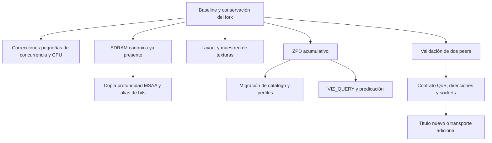

# 07 — Plan de mejora, dependencias y pruebas propuestas

Este backlog es una recomendación técnica derivada de la investigación. **No se han aplicado los cambios ni ejecutado las pruebas propuestas.** Las prioridades se basan en causa verificable, alcance y dependencias; no prometen cifras de rendimiento.

## Prioridades sugeridas

| Prioridad | Trabajo futuro | Motivo y aceptación |
| --- | --- | --- |
| P0 | Establecer baseline reproducible y snapshots de versiones | Registrar escena/build/config y reproducir el primer fallo; conservar cambios del fork |
| P1 | Lock de layouts Vulkan `1b242658e535` | Corregir carrera con causa clara; precarga paralela repetida sin corrupción |
| P1 | Barrera Vulkan `c8f214e2a9b0` | Corregir dependencia write-after-write; captura/validación sin hazard en recurso afectado |
| P1 | Alias color/profundidad `9da693480d09` | Defecto explícito de Judgment; sprites ocluidos y alias compartidos preservados |
| P1 | Errores CPU `9363df7d8fe0`, `5ce7c336df06`, `920f35c9386e` | Semántica concreta, probar constantes/dinámicos, lanes, NaN y registros vivos |
| P1 Linux | Vblank con deadline `44f5b4a86080` | Corregir deriva bajo carga; medir reloj/audio, no solo FPS |
| P2 | Layout/resolve: `0bd090dbe979`, `89609297c7ae`, `bc6b7a020295` y dependencias | Conservar representación entre MSAA/mips/tiled; pruebas de límites y escenas |
| P2 | Muestreo puntual `c3cd8617b18e` | Caso idTech 5, comparar GPU/vendors y otras texturas puntuales |
| P2 | Reescritura ZPD `3d233a5b2e94` | Modelo más general/QueryBatch; portar coherentemente y migrar opciones |
| P3 | VIZ_QUERY `692cd59cfef6` | Tras ZPD, analizar predicates, buffers y extensión Vulkan |
| P1 investigación red | Validar Gears System Link en dos PCs y después modo Netplay | Confirmar la cadena actual antes de diseñar otra infraestructura |
| P2 red | Contratos/límites de QoS, buffers, errores y shutdown | Evitar valores y lifetime incorrectos; payload, cancelación y completado controlados |
| P3 red | Título ausente o relay/servicio específico | Solo después de identificar dependencia real y topología bloqueante |
| Bloqueado por evidencia | Reintroducir mcrf `577fb8ee1745` | Aclarar revert de Netplay y contrato antes de recomendarlo |

Una prioridad P1 no significa que se pueda aplicar sin revisar. `candidate_applies` solo es una comprobación de contexto. La siguiente implementación deberá volver a comprobar la revisión y estado del árbol.

## Dependencias que evitan portados incompletos



El diagrama expresa orden recomendado y algunas dependencias explícitas de código; no pretende sustituir el análisis de todos los padres Git. EDRAM canónica, JIT publication y varias optimizaciones ya están presentes. No reaplicarlas por formar parte del plan.

## Preparación de un cambio futuro

1. Leer [base y auditoría](01-BASE-Y-EVIDENCIA.md), comprobar hashes y preservar trabajo existente. La `.gitmodules` y remote efectivos difieren: confirmar el repositorio/ref antes de actualizar.
2. Reproducir un fallo o medir un cuello de botella. Crear ficha del capítulo 06 y guardar resultados sin alterar datos activos.
3. Elegir una unidad coherente: código compartido, ambos backends si procede, headers y shaders, opciones, tests upstream relacionados y cambios del fork.
4. Revisar efectos en el parche reproducible `patches/xenia-netplay/0001-emulos360.patch` y scripts de preparación. Una edición del checkout que no se conserva en el flujo de reconstrucción puede perderse.
5. Construir solo las plataformas/rutas afectadas y probar el caso específico. Actualizar metadatos de compatibilidad solo al nivel probado.
6. Documentar causa, antes/después, compromisos, regresiones, hashes y limitaciones. Una captura correcta a 1x no valida escalado; una partida LAN no valida WAN.

No se propone actualizar el submódulo completo a Canary borrando Netplay ni resolver conflictos aceptando indiscriminadamente una rama. Para un rebase amplio conviene un entorno aislado y un mapa de commits equivalentes; ese trabajo no se ha realizado.

## Matriz de validación por subsistema

| Cambio | Prueba necesaria | Qué no basta |
| --- | --- | --- |
| CPU constant folding | Mismas entradas constantes/dinámicas; signed zero/NaN, lanes y tipos | Resultado de un juego que arranca |
| Registros x64 | Operand constantes y valores vivos bajo presión de registros | Caso con todos los registros libres |
| Publicación JIT | Compilación/resolución concurrente y readers coherentes | Compilar una función en un hilo |
| EDRAM/MSAA | Transferencias 1x/2x/4x, formato, bits conservados, escalado | Solo imagen final sin inspección de recurso |
| Alias depth/color | Writes disjuntos y solapados, stencil, depth read-only | Ocultar el efecto con parche del juego |
| Texturas | Base/mip, 2D/array/3D, packed tails, límites y formatos afectados | Textura 2D ordinaria de tamaño potencia de dos |
| Vulkan barrier | Dos uploads al mismo recurso en una submission y lectura posterior | Primer upload aislado |
| Layout mutex | Cache precargada con traducción paralela repetida y comprobación de datos | Lanzamiento con cache vacía |
| ZPD | Informes acumulativos, QueryBatch, reutilización, split/submission, escala y modos | Solo flare de una escena |
| VIZ_QUERY | Survey/consumer por generación, no-visible, copies/memexport y pass splits | Booleano de visibilidad sin draws consumidores |
| Vblank Linux | Recuento por tiempo, carga externa y pausa larga; audio/vídeo | FPS medios |
| XSession | Query/flags/slots, orden/tipo de propiedades, buffers y casos negativos | Sala publicada en backend |
| Overlapped | Pending, inmediata, wait/no-wait, autoreset, cancelación y cierre | Recepción bloqueante sin cancelación |
| QoS | Payload completo, límite, evento/pending y release | RTT constante mostrado en UI |
| NAT/transporte | Endpoints observados y bidireccionalidad en topología concreta | HTTPS del servidor funcionando |

Estas pruebas son significativas porque ejercitan la causa del cambio. No se propone ejecutar todas las suites upstream en cada edición documental o de UI. Para una implementación, seleccionar las pruebas afectadas y ampliar si aparece una regresión.

## Banco de juegos propuesto

Gears 1–3/Judgment aportan oclusión, alias, streaming y System Link reportado. Añadir un caso idTech 5 para fetchs puntuales, un juego con alias MSAA y uno que use QoS para descubrimiento. La selección depende de las copias disponibles y de un save/recorrido reproducible; no se descargan juegos ni se pide una campaña completa para comprobar un helper.

Para un cambio compartido CPU/GPU, un único título no representa todos los consumidores. Al menos comparar el caso afectado y otro que atraviese el contrato modificado. No mezclar captura de validación con benchmark instrumentado.

## Matriz mínima de online

Registrar por título y **modo**, con builds y contenido iguales:

| Escenario | Operaciones a comprobar |
| --- | --- |
| LAN, System Link autónomo | Descubrir, unir, iniciar, jugar, salir, recrear sesión |
| LAN, servicio de sesiones | Perfil habilitado, búsqueda/QoS, join, gameplay y limpieza |
| Host/client intercambiados | Cambiar roles y volver a crear una sesión |
| Sesión llena/privada o versión distinta | Rechazo correcto y ausencia de corrupción/bloqueo |
| Peer abandona o pierde transporte | Cancelación, timeout y recuperación según soporte del juego |
| WAN o VPN | Repetir con endpoints y puertos reales; documentar topología |
| Migración/voice/ranked | Probar separadamente si el modo lo ofrece; no inferir de un lobby |

Definir duración y número de repeticiones antes de ejecutar. No llamar estable a un comienzo de partida de unos segundos. Los fallos reproducibles y el estado posterior al cierre son parte del resultado.

## Plantilla de informe de mejora

```text
Problema reproducible:
Primer dato/estado incorrecto y contrato esperado:
Fuentes, commits y revisión local:
Cambio mínimo y dependencias:
Plataformas/backends probados:
Antes/después gráfico o funcional:
Frametime/carga/memoria/deriva (si se midieron):
Casos negativos y lifetime/cancelación:
Juegos/modos/topologías probados:
Compromisos de calidad o compatibilidad:
Pendientes y forma de revertir el cambio:
```

## Preguntas que siguen abiertas

- Motivo y efecto del revert `mcrf` en Netplay.
- Resultado real de Gears entre dos equipos con los cambios de Emulos360 y MultiP.
- Topologías WAN/NAT, migración y voz nativa del juego admitidas por cada versión.
- Comportamiento del nuevo ZPD y VIZ_QUERY al combinarlo con el fork y los parches propios.
- Límites/ownership de payload QoS y estructuras asíncronas en rutas poco usadas.
- Validación de algunas correcciones gráficas en Intel Arc y combinaciones concretas de drivers.
- Cobertura de servicios propios de editores para los juegos ausentes elegidos.

Son tareas concretas de investigación/validación pendientes. No se sustituyen por ajustes globales o afirmaciones de compatibilidad perfecta.
